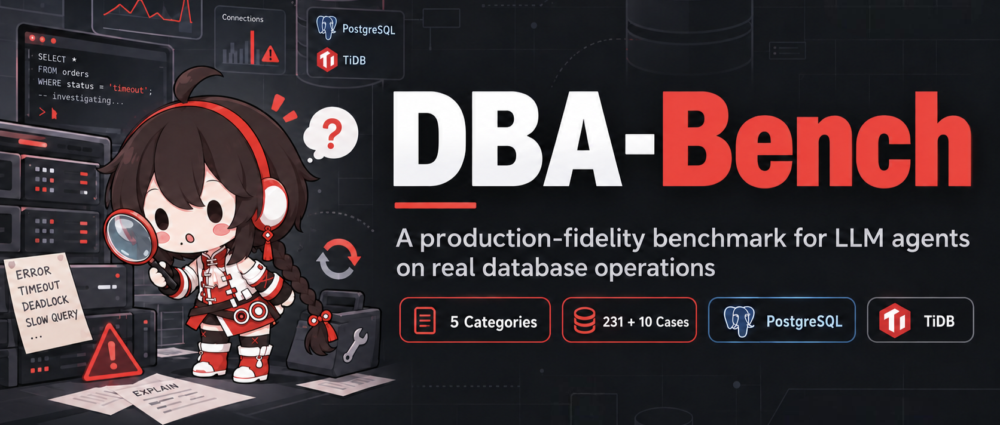
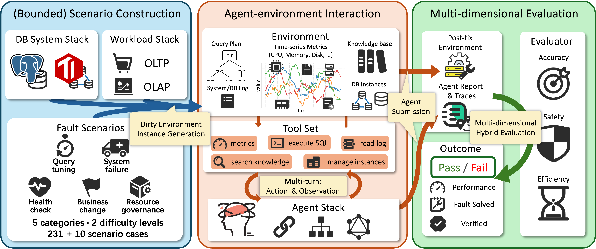

<div align="center">



# DBA-Bench

[](LICENSE)
[](https://arxiv.org/abs/2607.22165)
[](docs/getting-started.md)
[](docs/getting-started.md#2-docker)

**113 Scenarios · 241 Cases — 231 ScenarioCases + 10 Persistent Episodes · 2 database systems · 5-phase fault lifecycle · 4 built-in baselines**

📄 Paper: [arXiv:2607.22165](https://arxiv.org/abs/2607.22165) · English · [简体中文](README.zh-CN.md)

</div>

## How it works



**Scenario Construction** builds dirty-environment PostgreSQL/TiDB instances from a fault catalog
under OLTP/OLAP workloads. **Agent–environment interaction** lets any agent operate the broken
system through a shared tool plane in multi-turn action–observation cycles.
**Multi-dimensional evaluation** scores every run on outcome (pass/fail with business-verified
ground truth), diagnosis accuracy, safety, and efficiency — the DP/OP/SP contract.

## Why DBA-Bench

Most agent benchmarks grade a final answer. Database operations are graded by the system itself —
and DBA-Bench exploits that end to end:

- **Full fault lifecycle** — every case runs through five phases: fault injection → detection → diagnosis → remediation → recovery, with per-phase evidence in the trace.
- **DP / OP / SP evaluation contract** — Diagnosis Point, Operation Point, and Safety Point are declared per case, so scoring is a contract, not a vibe. Semantic judgment by an LLM judge is supported but never required.
- **Calibrated difficulty** — cases ship as Easy/Hard pairs with recorded model evidence, not a single "can it fix it" binary.
- **Persistent long-horizon episodes** — asynchronous, long-running operations tasks with monotonic event arrival, fresh alert/inspection sessions, checkpoints, and reverse-order capability cleanup.
- **Business-grounded ground truth** — outcome checks compare real business-query result snapshots against expected values, not proxy metrics.
- **One tool plane, two systems** — the same `query_metrics` / `execute_sql` / `manage_instance` / `read_log` interface drives both PostgreSQL and TiDB, so agents are portable across engines.

## Scenario landscape

Counts below come from the registry-backed catalogs
([PostgreSQL](docs/catalogs/postgresql-scenarios.catalog.md) · [TiDB](docs/catalogs/tidb-scenarios.catalog.md));
`Scenario/Case` per category:

| Category | PostgreSQL | TiDB |
|---|---|---|
| `query_perf` | 9 / 19 | 11 / 22 |
| `system_failure` | 16 / 33 | 14 / 28 |
| `health_check` | 9 / 21 | 11 / 22 |
| `business_change` | 8 / 16 | 13 / 26 |
| `resource_governance` | 9 / 18 | 13 / 26 |
| **Total** | **51 / 107** | **62 / 124** |
Beyond the 231 ScenarioCases above, the benchmark ships **10 persistent long-horizon episodes** (5 PostgreSQL · 5 TiDB) with monotonic event arrival, multi-session alert/inspection mailboxes, and checkpoints.

Each ScenarioCase is a code-backed contract with registered cases, evaluator identity, and a calibration snapshot (see any contract under `docs/scenarios/`).

## Quick start

Prerequisites: **Python 3.10+** and **Docker** (the mock demo boots a real `postgres:16`
container). All scenario data ships with the repository; only the optional TPC-DS demo needs
a separate download (see [docs/getting-started.md](docs/getting-started.md) §7).
For the full environment walkthrough — Python, Docker setup, registry mirrors, LLM credentials,
embedding and judge models — see **[docs/getting-started.md](docs/getting-started.md)**.

```bash
# 1) Install
python3 -m venv .venv && source .venv/bin/activate
pip install -U pip && pip install -e .

# 2) Zero-credential mock demo: a scripted agent heals a PostgreSQL container
python examples/run_mock_llm_demo.py

# 3) TiDB demo (Docker Compose: PD + TiKV + TiDB + Prometheus)
python examples/run_tidb_demo.py

# 4) Tests (unit tests run anywhere; scenario tests deploy containers)
pytest tests/
```

## Connect your own agent

Agents drive the environment through one tool plane (`src/agents/factory.py` builds them):

| Tool | Purpose |
|---|---|
| `query_metrics(metric_type, target)` | Environment observations: `cpu`, `memory`, `qps`, `active_connections`, `slow_queries`, `topsql`, ... |
| `execute_sql(sql_query)` | Arbitrary SQL against the target database |
| `manage_instance(action, target)` | Lifecycle actions: `restart`, `start`, `stop` |
| `read_log(log_type, ...)` | Bounded database and container logs |
| `submit(report)` / `exit` | Protocol control |

LLM agents return JSON actions:

```json
{"thinking": "connections are piling up in idle state...", "action": {"api": "execute_sql", "args": {"sql_query": "SELECT state, count(*) FROM pg_stat_activity GROUP BY state"}}}
```

OpenAI-compatible and Anthropic-native function calling are both supported; credentials live in
`config/llm_config.json` (start from `config/llm_config.example.json`).

## Built-in baselines

Reproductions of published database-troubleshooting agents, sharing the same tool plane and scenarios:

| Baseline | Entry point |
|---|---|
| D-Bot | `examples/run_dbot_baseline.py` |
| Panda | `examples/run_panda_baseline.py` |
| DBAIOps | `examples/run_dbaiops_baseline.py` |
| Andromeda | `examples/run_andromeda_baseline.py` |

## Run a formal experiment

Experiment manifests select systems, categories, agents, seeds, and repetitions
(full field reference: [run-experiment guide](docs/guides/benchmark/run-experiment.guide.md)):

```yaml
experiment_id: pg-smoke
benchmark:
  systems: [postgresql]
  categories: [query_perf]
  scenarios: [pg_query_perf_missing_index]
agents:
  - {id: mock, mode: mock}
repetitions: 1
seeds: [11]
runtime:
  fault_snapshot: auto
  agent_language: en   # optional: zh (default) or en; English covers PostgreSQL bounded scenarios
```

```bash
aiopsbench experiment plan experiments/pg_smoke.example.yaml
aiopsbench experiment run  experiments/pg_smoke.example.yaml
```

Persistent (long-horizon) episodes use `scenario_kind: persistent` — see the
[persistent scenario guide](docs/guides/persistent-scenario/implement-persistent-scenario.guide.md).

## Extend it

- **Add a scenario** → [implement-scenario-case guide](docs/guides/scenario/implement-scenario-case.guide.md) and the [difficulty standard](docs/standards/scenario/difficulty.standard.md)
- **Add a persistent episode** → [implement-persistent-scenario guide](docs/guides/persistent-scenario/implement-persistent-scenario.guide.md)
- **Understand the architecture** → [scenario architecture standard](docs/standards/scenario/architecture.standard.md) · [evaluation contract](docs/standards/evaluation/dp-op-sp.standard.md)

## Citation

If you use DBA-Bench, please cite the companion paper
([arXiv:2607.22165](https://arxiv.org/abs/2607.22165)):

```bibtex
@misc{chen2026dbabench,
  title         = {DBA-Bench: A Production-Fidelity Benchmark for LLM-Based Database Operations Agents},
  author        = {Junming Chen and Junyang Jiang and Xu Chen and Zibo Liang and Kai Zheng},
  year          = {2026},
  eprint        = {2607.22165},
  archivePrefix = {arXiv},
  primaryClass  = {cs.DB},
  url           = {https://arxiv.org/abs/2607.22165}
}
```

## License

Released under the [Apache License 2.0](LICENSE).
